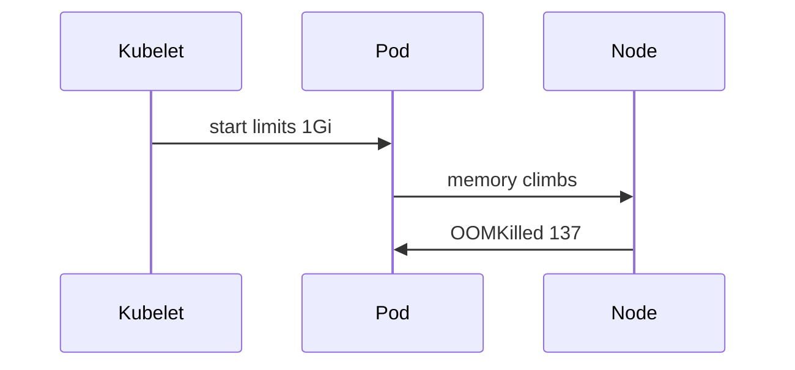

# 54. Resource limits

**Category:** Platform  |  **Status:** Scaffold - implement the TODOs

Requests/limits, OOMKilled, MaxRAMPercentage.

## Sequence


## Run
```bash
# no infrastructure needed
mvn spring-boot:run
```

## Part of
[system-design-concepts-master](../../README.md) - see the master repo for the full concept map.
